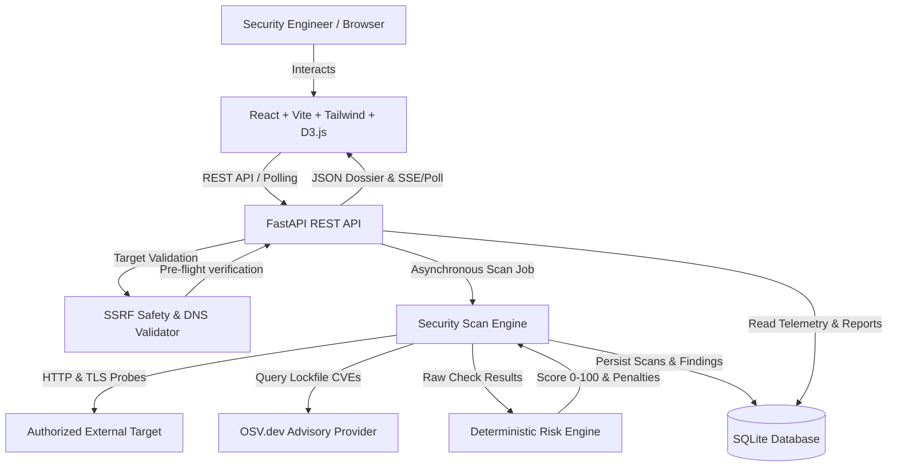

# SentinelSec / AnalyticsPro

[](https://github.com/sentinelsec/scanner)
[](https://www.python.org/)
[](https://fastapi.tiangolo.com/)
[](https://react.dev/)
[](https://d3js.org/)

**SentinelSec / AnalyticsPro** is an automated, defensive web application security assessment, vulnerability auditing, and threat telemetry platform. Built for security engineers, system administrators, and DevOps teams, SentinelSec identifies transport-layer weaknesses, insecure HTTP configurations, public sensitive file exposures, TLS certificate risks, and known software supply chain CVEs.

---

## Architecture Overview



---

## Key Features

1. **Automated Non-Destructive Scanning:** Executes 16 modular security checks across Transport Security, HTTP Headers, Information Disclosure, and TLS Certificate Chains without exploitation or load stress.
2. **Server-Side Request Forgery (SSRF) Protection:** Rejects loopback, private RFC 1918, link-local, multicast, and cloud instance metadata (169.254.169.254) addresses by default.
3. **Software Supply Chain Intelligence:** Parses `package-lock.json`, `npm-shrinkwrap.json`, `requirements.txt`, and `poetry.lock`. Fetches known CVEs from the Open Source Vulnerabilities (OSV) API with local caching and offline graceful fallback.
4. **Deterministic Risk Scoring:** Scores posture from 0 to 100 with itemized deductions, confidence weighting, and duplicate dampening to eliminate artificial score inflation.
5. **Interactive D3.js Telemetry:** Renders interactive Donut Charts for severity distribution, horizontal bar charts for category proportions, and line/area charts for score drift over time.
6. **Historical Scan Comparison:** Side-by-side diffing of any two scans to immediately identify newly introduced, resolved, and recurring findings.
7. **Redacted Evidence Preservation:** Automatically sanitizes authorization headers, cookies, session IDs, and secret tokens in stored database evidence and reports.
8. **Standardized JSON Export:** Downloadable schema-versioned JSON security reports with remediation instructions and CWE/OWASP references.
9. **Simulated Baseline Demo Mode:** Single-click capability to seed realistic baseline scans and telemetry without scanning arbitrary targets.

---

## Technology Stack

- **Backend:**
  - Python 3.12
  - FastAPI & Pydantic v2
  - SQLAlchemy 2.0 & Alembic migrations
  - HTTPX for controlled HTTP client requests
  - Python `ssl`, `socket`, and `cryptography.x509` for TLS certificate inspection
  - Pytest & HTTPX test utilities
- **Frontend:**
  - React 19 & TypeScript
  - Vite & Tailwind CSS v4
  - D3.js (Data-Driven Documents) for visualizations
  - React Router DOM v7
  - Lucide React Icons
- **Database & Infrastructure:**
  - SQLite (Local persistent database by default; zero paid infrastructure)
  - Docker & Docker Compose

---

## Implemented Security Checks

SentinelSec implements 16 non-destructive security checks:

| Check ID | Check Name | Category | Severity | Standard |
|---|---|---|---|---|
| `SEC-HTTP-001` | **HTTPS Availability** | Transport Security | High | CWE-319 |
| `SEC-HTTP-002` | **HTTP to HTTPS Redirect** | Transport Security | Medium | CWE-319 |
| `SEC-CSP-003` | **Content-Security-Policy** | HTTP Headers | Medium | CWE-1021 |
| `SEC-HSTS-004` | **Strict-Transport-Security** | HTTP Headers | Medium | CWE-523 |
| `SEC-XCTO-005` | **X-Content-Type-Options** | HTTP Headers | Low | CWE-16 |
| `SEC-FRAME-006` | **Frame Protection (Clickjacking)** | HTTP Headers | Medium | CWE-1021 |
| `SEC-REFPOL-007`| **Referrer-Policy** | HTTP Headers | Low | CWE-200 |
| `SEC-PERMPOL-008`| **Permissions-Policy** | HTTP Headers | Info | CWE-16 |
| `SEC-CORS-009` | **CORS Configuration** | Access Control | High | CWE-942 |
| `SEC-COOKIE-010`| **Cookie Security Flags** | HTTP Headers | Medium | CWE-614 / 1004 |
| `SEC-INFODISC-011`| **Information Disclosure** | Info Disclosure | Low | CWE-200 |
| `SEC-DIRLIST-012`| **Directory Listing Indicators** | Info Disclosure | Medium | CWE-548 |
| `SEC-PATH-013` | **Sensitive Path Exposure** | Info Disclosure | High | CWE-538 |
| `SEC-TLS-014`  | **TLS Certificate Expiry** | Certificate | High / Critical | CWE-298 |
| `SEC-TLS-015`  | **Certificate Hostname & Trust** | Certificate | High | CWE-295 / 297 |
| `SEC-TLS-016`  | **TLS Protocol Configuration** | Transport Security | High | CWE-326 |

---

## Risk Scoring Formula

The score is computed deterministically between 0 and 100:

$$\text{Final Score} = \max\left(0, \min\left(100, 100 - \sum \text{Deductions}\right)\right)$$

### Base Severity Deductions:
- **Critical:** 25.0 points
- **High:** 15.0 points
- **Medium:** 8.0 points
- **Low:** 3.0 points
- **Informational:** 0.0 points

### Confidence Multipliers:
- `high`: $1.0\times$
- `medium`: $0.8\times$
- `low`: $0.5\times$

### Duplicate Dampening:
To avoid penalizing repeated instances of the same root rule (e.g., 5 cookies missing HttpOnly):
- 1st Occurrence: $100\%$ base deduction
- 2nd Occurrence: $35\%$ base deduction
- 3rd Occurrence: $15\%$ base deduction
- Subsequent Occurrences: $5\%$ base deduction

A score of 100 denotes passing all configured automated checks; it does not guarantee the absence of unknown or application-logic zero days.

---

## Getting Started

### Prerequisites

- Python 3.12+
- Node.js 20+ & npm

---

### Local Installation & Development

#### 1. Backend Setup

```bash
# In project root:
cd backend

# Install Python dependencies
pip install -r requirements.txt

# Run database migrations
python -m alembic -c alembic.ini upgrade head

# Start FastAPI backend development server
uvicorn app.main:app --host 127.0.0.1 --port 8000 --reload
```

The API is now running at `http://127.0.0.1:8000`.  
Swagger documentation is available at `http://127.0.0.1:8000/docs`.

#### 2. Frontend Setup

```bash
# In frontend directory:
cd frontend

# Install Node modules
npm install

# Start Vite dev server
npm run dev
```

The frontend will be accessible at `http://localhost:5173`. Calls to `/api` are automatically proxied to the FastAPI server.

---

### Docker Deployment

To run both backend and frontend in Docker containers:

```bash
docker compose up --build -d
```

- Frontend: `http://localhost:5173`
- Backend API & Swagger: `http://localhost:8000/docs`

---

## Running the Automated Test Suite

```bash
# Run all unit and integration tests
python -m pytest backend/tests -v
```

All 36 tests run offline without querying unauthorized network targets, utilizing controlled mock responses and SSL fixtures.

To verify frontend TypeScript types and production build:

```bash
cd frontend
npm run build
```

---

## REST API Endpoints

- `GET /api/health` — Service health status
- `GET /api/health/ready` — Database connection readiness
- `POST /api/scans` — Initiate a security assessment
- `GET /api/scans` — Paginated list of assessments with filters
- `GET /api/scans/{id}` — Single assessment details
- `GET /api/scans/{id}/progress` — Live scan progress and current check
- `GET /api/scans/{id}/findings` — Filterable findings list
- `POST /api/scans/{id}/cancel` — Cooperative cancellation
- `POST /api/scans/{id}/compare/{other_id}` — Compare two scans
- `POST /api/scans/dependencies/scan` — Scan manifest/lockfile for CVEs
- `GET /api/findings/{id}` — Full vulnerability dossier
- `PATCH /api/findings/{id}` — Update finding status (`open`, `resolved`, `accepted_risk`)
- `GET /api/analytics/overview` — Posture metrics and KPIs
- `GET /api/analytics/trends` — D3-ready telemetry data
- `GET /api/reports/{id}/json` — Downloadable standardized JSON report
- `GET /api/settings` — Scanner configurations and safety limits
- `POST /api/settings/update` — Update timeout and local targets policy
- `POST /api/settings/demo/seed` — Populate 3 simulated baseline scans
- `POST /api/settings/demo/clear` — Remove simulated demo records

---

## Defensive Boundaries & Safe-Use Policy

1. **Permission Required:** Users must explicitly confirm authorization before scanning any target.
2. **SSRF Protections:** Private RFC 1918 addresses, loopbacks (127.0.0.1), link-local (169.254.x.x), multicast, and cloud metadata endpoints are rejected by default.
3. **Non-Destructive Scanning:** No SQL injection testing, password cracking, credential spraying, recursive crawlers, or denial-of-service tests.
4. **Data Redaction:** Authentication tokens, bearer headers, and cookies are redacted prior to persistence.
